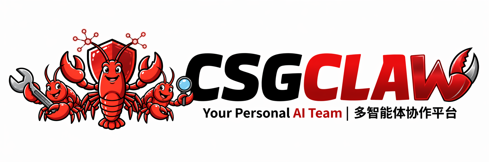
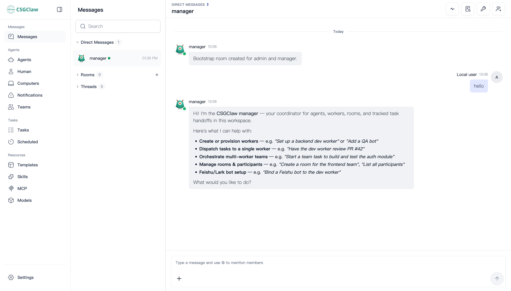

<p align="center">
  
</p>

<p align="center">
  English | <a href="./README.zh.md">中文</a>
</p>

# CSGClaw Win7

> Your Personal AI Team

## Windows 7 compatibility experiment

This repository contains an experimental Windows 7 SP1 x64 port based on
[CSGClaw v0.8.0](https://github.com/OpenCSGs/csgclaw/tree/v0.8.0).
It uses Electron 22.3.27, a pinned Win7 Go toolchain, and a Web UI targeting
Chromium 108. Desktop updates are disabled for this build.

The [Win7 compatibility workflow](.github/workflows/win7-compat.yml) builds a
portable ZIP on the `codex/win7-v0.8-electron22` branch. Download the ZIP from
the workflow artifacts; the upstream installation commands below install the
regular release and are not the Win7 installation path.

Current validation in a UTM Windows 7 SP1 x64 VM:

- The desktop application and Web UI launch.
- STG login state and model configuration can be imported.
- HTTPS model requests still fail with a TLS handshake timeout.
- The bundled Codex runtime exits during initialization with `0xC0000139`.

Agent question answering has not passed on Windows 7. The runtime and HTTPS
issues remain unresolved.

## Upstream project

CSGClaw is a multi-agent collaboration platform built by OpenCSG — designed around one practical question: **once work becomes non-trivial, how do you get a group of AI agents to operate like a team, without the system becoming heavy or painful to set up?**



## Install

**macOS / Linux:**

```bash
curl -fsSL https://csgclaw.opencsg.com/install.sh | bash
```

**Windows (PowerShell):**

```powershell
curl.exe -fsSL https://csgclaw.opencsg.com/install.ps1 | powershell -ExecutionPolicy Bypass -Command -
```

The installers download a prebuilt release bundle, install it into user-local directories, and put `csgclaw` on your `PATH`.

- `install.sh` currently supports macOS arm64, Linux amd64, and Linux arm64.
- `install.ps1` currently supports Windows amd64.

Official release bundles are also published for macOS amd64 and Windows amd64. Windows bundles currently default to Docker and require a working local Docker installation.

**Build from source:**

```bash
make build
```

See [docs/tech/build.md](docs/tech/build.md) for runtime image refs, sandbox CLI packaging, and other Makefile targets.

**Build the desktop app (Electron):**

```bash
make desktop-package
```

This builds a desktop installer for the current platform. Outputs are written to
`desktop/out/make/`.

On Windows without `make`:

```powershell
.\scripts\build.cmd desktop-package
```

For signed and notarized macOS release packages, see the
[desktop signing and release guide](docs/tech/desktop/electron-desktop-signing.zh.md).

For most users, the install script above is the simpler option.

## Quick Start

```bash
csgclaw serve
```

CSGClaw prints the IM workspace URL without opening a browser by default.
Use `csgclaw serve --browser` to open it automatically after startup.

## Configuration

`csgclaw serve` uses a local config with server, bootstrap, sandbox, and channel settings, and auto-creates any missing bootstrap state on first run. Agent model/provider profiles are stored in agent state and managed from the Web UI. See [docs/tech/config.md](docs/tech/config.md) for sandbox provider options, Worker override examples, and agent profile details.

Maintainer-facing architecture, API, structured skill output, and IM thread design notes live in [docs/tech/architecture.md](docs/tech/architecture.md), [docs/tech/api.md](docs/tech/api.md), [docs/tech/structured-output.md](docs/tech/structured-output.md), and [docs/tech/im/im-threads.md](docs/tech/im/im-threads.md).

## Features

- **Multi-agent coordination** — work with a team of specialized agents through a single coordination point, not a pile of chat windows
- **One-click install** — prebuilt releases for macOS arm64/amd64, Linux amd64/arm64, and Windows amd64; up and running in minutes
- **WebUI out of the box** — browser-based workspace available immediately after `csgclaw serve`
- **Multi-channel support** — connect Feishu, WeChat, Matrix, or other channels when needed
- **Isolated execution** — each Worker runs in a secure sandbox with security boundaries enabled by default
- **Role-based Workers** — specialize Workers for frontend, backend, testing, docs, research, and more

## What CSGClaw Is

CSGClaw gives you one **Manager** and a set of specialized **Workers**, so instead of juggling isolated agents, you work through a single coordination point for defining goals, breaking down work, assigning roles, tracking progress, and collecting results.

```text
┌────────────────────────────────────────────────────────────┐
│                         CSGClaw                            │
│  ┌──────────────────────────────────────────────────────┐  │
│  │ Manager — understands goals, plans, coordinates      │  │
│  └──────────────────────────────────────────────────────┘  │
│               ↓                      ↓                     │
│        Worker Alice            Worker Bob                  │
│          frontend                 backend                  │
│                                                            │
│   WebUI / Feishu / WeChat / Matrix / other channels        │
└────────────────────────────────────────────────────────────┘
                      ↑ you make decisions
```

**Manager** — receives your goals, decomposes tasks, selects Workers, tracks progress, and consolidates results.

**Workers** — role-specific executors (frontend, backend, testing, docs, research…). Specialization keeps context clean and reduces role confusion.

**Sandbox** — Worker execution is isolated by the configured sandbox provider. CSGClaw defaults to **Docker** when the provider is unset. The deprecated BoxLite provider remains available through explicit configuration for legacy development use.

**Interface** — WebUI out of the box; Feishu, WeChat, Matrix, and other channels available as integrations.

## A Typical Workflow

```text
You: Build a web app prototype — landing page, login, and basic admin view.

Manager: Splitting into tasks.
  · Alice → landing page & login UI
  · Bob   → backend APIs & data model
  · Carol → integration checks

You: Add GitHub login to the login flow.

Manager: Updating Alice and Bob.

Carol: Login response is missing the user avatar field.

Manager: Bob updates the API first; Alice updates the UI once the field contract is confirmed.
```

The key isn't that multiple agents exist — it's that **their collaboration is organized**.

## Design Principles

**PicoClaw by default, extensible by design.**
CSGClaw uses PicoClaw as its lightweight default Agent Runtime, keeping the Manager fast to start and cheap to run. The runtime remains pluggable, so deployments can integrate alternatives such as OpenClaw when needed.

**Docker by default, sandbox-agnostic by design.**
Isolation is non-negotiable. Docker is the default sandbox provider for broad cross-platform availability. The deprecated BoxLite provider remains supported only for explicitly configured legacy development environments.

**WebUI first, channel-agnostic by design.**
Many multi-agent systems are tightly coupled to one messaging protocol. CSGClaw ships with a built-in WebUI so you can start immediately, while keeping other channels (Feishu, WeChat, Matrix) as optional integrations — not assumptions.

## Who It Is For

- Independent developers who want an AI team, not just a single assistant
- Small teams that want lower-friction multi-agent collaboration
- Users who value fast startup, lighter runtime, and sensible defaults

## Acknowledgement

CSGClaw is informed by ideas explored in HiClaw around multi-agent usability, while placing stronger emphasis on lightweight runtime, easier local startup, and a platform model not bound to a single communication channel.

## License

CSGClaw is licensed under the Apache License 2.0. See [LICENSE](LICENSE) for details.
